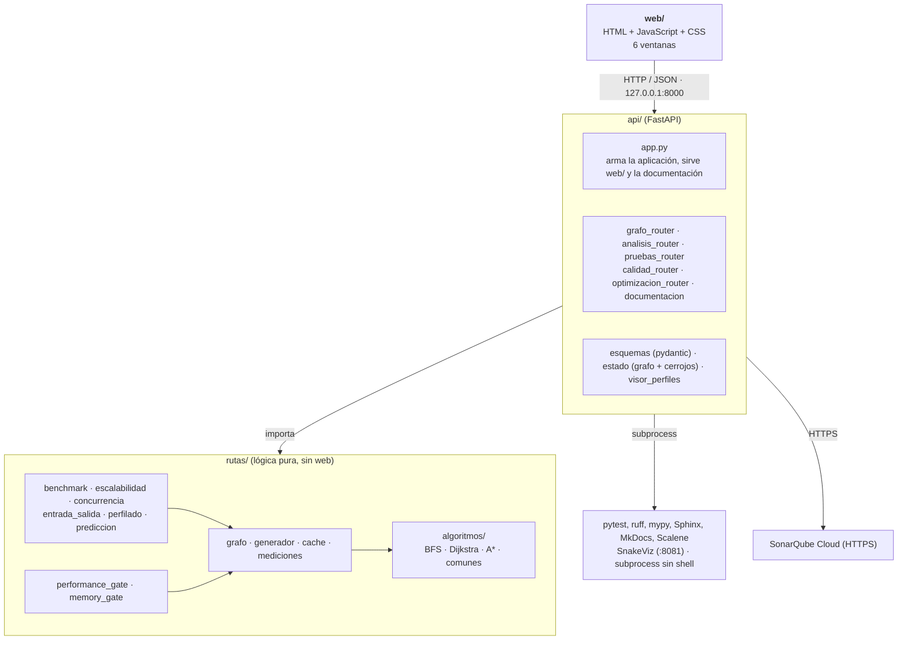

# Arquitectura

La aplicación tiene tres capas. Cada una solo conoce a la de abajo:

1.  **Interfaz** (`web/`): páginas HTML con JavaScript que consumen la API.
2.  **API** (`api/`): FastAPI. Valida las entradas, mantiene el estado compartido y traduce los resultados a JSON.
3.  **Lógica** (`rutas/`): grafo, algoritmos, caché, mediciones y experimentos. No conoce a la web: se puede usar desde la consola, desde las pruebas o desde el pipeline.

## Diagrama de componentes

## Módulos y responsabilidades

| Módulo                                               | Responsabilidad                                                                                                        |
|------------------------------------------------------|------------------------------------------------------------------------------------------------------------------------|
| `main.py`                                            | Punto de entrada: levanta uvicorn en `127.0.0.1:8000`.                                                                 |
| `api/app.py`                                         | Crea la aplicación, registra los routers, sirve `web/` en `/estatico` y genera la documentación si falta.              |
| `api/grafo_router.py`                                | Editor: nodos, conexiones y búsqueda de rutas.                                                                         |
| `api/analisis_router.py`                             | Benchmark, escalabilidad, caché, concurrencia, perfilado, entrada/salida y predicción.                                 |
| `api/pruebas_router.py`, `api/calidad_router.py`     | Ejecutan la suite y consultan SonarQube Cloud.                                                                         |
| `api/optimizacion_router.py`, `api/documentacion.py` | Herramientas de limpieza de código y generación de esta documentación.                                                 |
| `api/estado.py`                                      | Guarda el grafo en memoria y los cerrojos que evitan que dos peticiones lo modifiquen a la vez o falseen una medición. |
| `api/esquemas.py`                                    | Modelos pydantic: validan cada entrada antes de llegar a la lógica.                                                    |
| `rutas/grafo.py`                                     | Estructura de datos del grafo (listas de adyacencia en un `dict`).                                                     |
| `rutas/algoritmos/`                                  | BFS, Dijkstra y A\*, con una firma común y un registro `ALGORITMOS`.                                                   |
| `rutas/cache.py`                                     | Caché de rutas con invalidación por versión del grafo.                                                                 |
| `rutas/mediciones.py`                                | Mide tiempo y pico de memoria de una consulta.                                                                         |
| `rutas/generador.py`                                 | Grafos y consultas reproducibles a partir de una semilla.                                                              |
| `rutas/benchmark.py`, `rutas/escalabilidad.py`       | Comparación de algoritmos y crecimiento con el tamaño del grafo.                                                       |
| `rutas/concurrencia.py`, `rutas/entrada_salida.py`   | Hilos y procesos; lectura y escritura de archivos grandes.                                                             |
| `rutas/perfilado.py`, `rutas/perfilado_scalene.py`   | Perfilado con cProfile, line_profiler, memory_profiler y Scalene.                                                      |
| `rutas/prediccion.py`                                | Regresión lineal que predice el tiempo de una búsqueda.                                                                |
| `rutas/performance_gate.py`, `rutas/memory_gate.py`  | Controles de tiempo y de memoria que ejecuta el pipeline.                                                              |
| `rutas/procesos.py`                                  | Ejecuta herramientas externas como módulos de Python, sin `shell`.                                                     |

## Reglas de dependencia

- `rutas` **nunca importa** `api`: la lógica se puede probar y reutilizar sin servidor web.
- `rutas/algoritmos` depende solo de `rutas.grafo`.
- `rutas.grafo` y `rutas.procesos` no dependen de ningún otro módulo del proyecto.
- Agregar un algoritmo exige escribir su función y registrarla en `ALGORITMOS`; el editor, la caché, el benchmark y el perfilado lo recorren y no se modifican.

## Dependencias externas

| Paquete                                                   | Para qué se usa                                                      |
|-----------------------------------------------------------|----------------------------------------------------------------------|
| FastAPI, uvicorn, pydantic                                | Servidor web, enrutamiento y validación de entradas.                 |
| httpx                                                     | Consulta a SonarQube Cloud y cliente de prueba de la API.            |
| pytest, pytest-cov                                        | Pruebas y cobertura.                                                 |
| psutil, memory-profiler, line_profiler, SnakeViz, Scalene | Mediciones y perfilado.                                              |
| scikit-learn                                              | Modelo de predicción de tiempos.                                     |
| MkDocs Material                                           | Documentación externa (este sitio).                                  |
| Sphinx                                                    | Referencia interna del código, generada de los *docstrings*.         |
| Ruff, mypy, Pylint, Vulture, Radon, Bandit, pip-audit     | Controles de calidad y seguridad del pipeline (ver [Mantenimiento](mantenimiento.md)). |

## Estado y concurrencia

Hay **un solo grafo por servidor**, guardado en memoria en `api/estado.py`. `cerrojo_grafo` impide que dos peticiones lo modifiquen a la vez. `cerrojo_medicion` serializa las mediciones porque `tracemalloc` es global al proceso y dos mediciones simultáneas se falsearían. Al arrancar, la documentación se genera en un hilo aparte para no bloquear el inicio del servidor.
